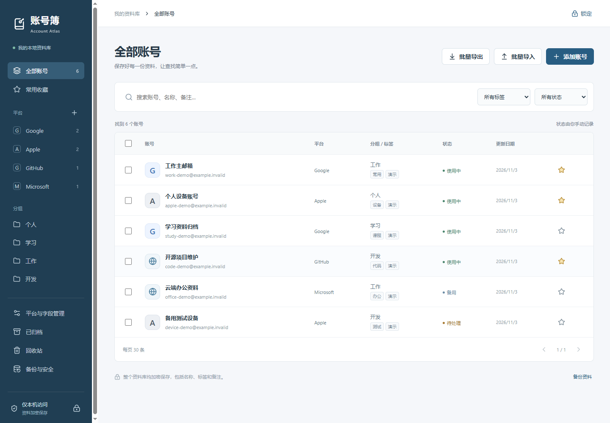
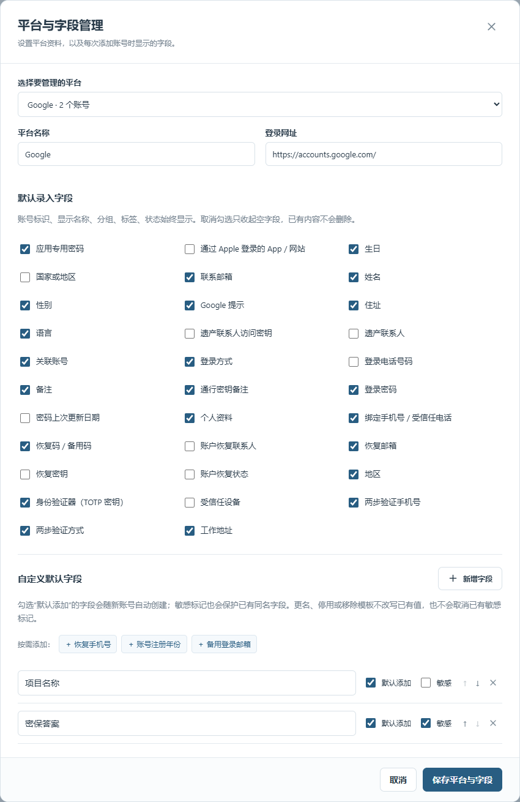
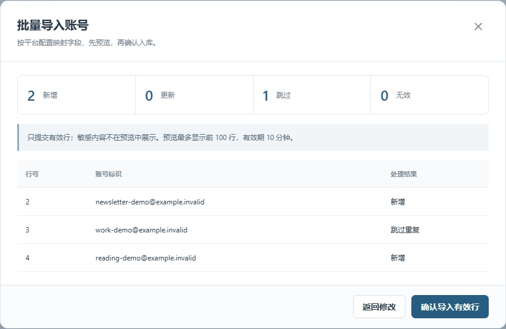
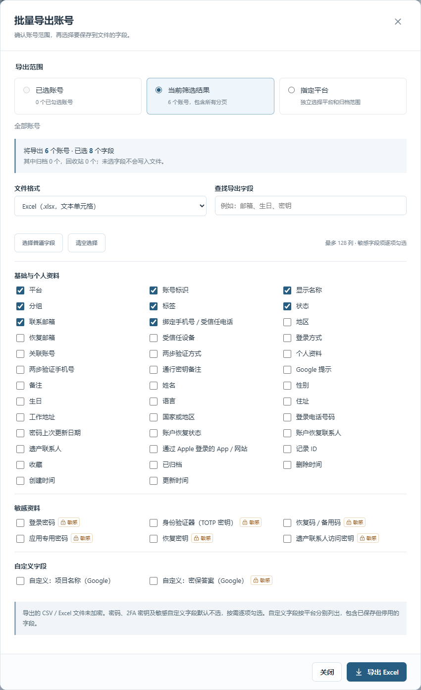
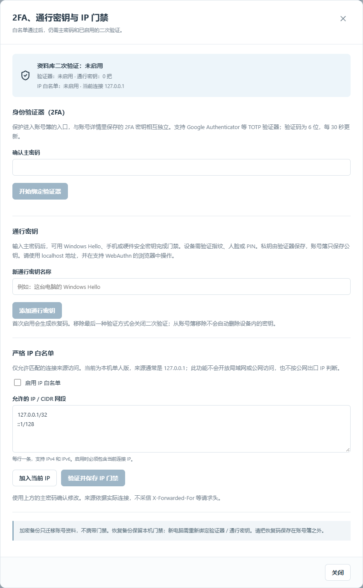

# 账号簿 · Account Atlas

把 Google、Apple 和其他平台的账号资料，集中保存在你自己的电脑上。

账号簿是一款 **Windows 本地单人账号管理工具**：支持分类搜索、平台字段配置、批量导入导出、加密备份，以及 2FA / 通行密钥 / IP 门禁。适合整理多个邮箱、设备账号、开发账号和备用账号。不执行自动登录、账号有效性检测或远程账号修改。

默认在本机运行；另提供显式配置的 [HTTPS 服务器模式](docs/HTTPS-DEPLOYMENT.md)，使用离线地域限制及强制双重验证。服务器模式把加密资料保存在你管理的服务器上，请按部署文档设置独立数据目录和代理认证。

[快速开始](#快速开始) · [功能介绍](#功能介绍) · [使用说明](#使用说明) · [界面截图](#界面截图) · [常见问题](#常见问题) · [详细指南](docs/USER-GUIDE.md)

> 所有截图均来自独立演示资料库。邮箱使用 `example.invalid`，名称和分类均为虚构；不包含真实账号、密码、TOTP 密钥、恢复码或设备凭据。安装后的资料库是空的，不附带演示记录。



## 功能介绍

| 功能 | 可以做什么 |
| --- | --- |
| 多平台管理 | 内置 Google、Apple；添加自定义平台，配置名称和登录网址 |
| 账号资料 | 保存账号标识、个人资料、联系与恢复信息、设备备注、密码及自定义内容 |
| 字段模板 | 为每个平台选择默认字段；自定义字段支持排序、启停和敏感标记 |
| 分类与搜索 | 按平台、分组、标签、状态筛选；搜索账号、名称、备注及非敏感自定义字段 |
| 批量整理 | 调整分组、标签和状态；收藏、归档、移入回收站、恢复或永久删除 |
| 快捷查看 | 详情字段可复制；敏感内容需主动查看；保存 TOTP 密钥后可显示实时验证码 |
| 批量导入 | 下载平台 CSV 模板，映射内置与自定义字段，预览新增、更新、跳过及无效行 |
| CSV / Excel 导出 | 按已选账号、当前筛选结果或平台导出；自由选择字段，敏感字段默认不选 |
| 加密存储与备份 | 整库 AES-256-GCM 加密；独立密码的 `.atlas` 备份，支持恢复和迁移 |
| 访问门禁 | 主密码解锁，可叠加 TOTP 或通行密钥验证；严格 IP 白名单和闲置锁定 |

当前容量：最多 **10,000 个账号**，整库解密内容上限 **10 MB**；单次导入最多 **5,000 条**，导入与导出最多 **128 列**。账号状态由你手动记录，不代表平台端的实际状态。

Apple 账户使用独立字段范围，区分主要登录地址、其他邮箱、登录电话号码、受信任电话号码、双重认证及实体安全密钥。点击“显示此平台可选字段”可填写付款、配送、订阅、家庭、设备和隐私备注；旧记录中的补充字段仍可编辑和保存。所有信息均为手动台账，不会修改 Apple 设置。

## 快速开始

### 1. 准备环境

当前安装脚本及锁定依赖面向 **Windows**。macOS / Linux 尚未提供验证过的安装流程。

| 依赖 | 要求 |
| --- | --- |
| Python | 64 位，3.12 或更高；建议使用 3.12，并加入 PATH |
| Node.js | 22.12 或更高，包含 npm；用于首次安装和重新构建 |
| 浏览器 | 支持现代 Web API 的浏览器；通行密钥需浏览器与验证器支持 WebAuthn |
| Git | 可选；也可以下载源码 ZIP |

在终端运行 `python --version`、`node --version`、`npm --version`，确认命令可用。首次安装需要联网下载依赖；日常管理账号无需联网，也不需要启动 Node.js 开发服务器。

### 2. 获取源码并安装

使用 Git：

```powershell
git clone https://github.com/Yiya-ai/account-atlas.git
cd account-atlas
.\install.cmd
.\start.cmd
```

不使用 Git：在仓库页面选择 **Code → Download ZIP**，完整解压到可写目录，依次双击 **install.cmd** 和 **start.cmd**。不要直接在 ZIP 内运行脚本。

安装脚本会创建 `.venv`、安装锁定的 Python / npm 依赖并构建前端。启动后浏览器打开 **<http://localhost:8765/>**。旧的 `127.0.0.1:8765` 页面入口会跳转到 `localhost`；使用通行密钥时请保持相同主机名和端口。

### 3. 创建你的资料库

1. 首次打开时选择“全新资料库”。
2. 设置至少 **12 个字符**的主密码，并再次确认。没有默认密码或预置真实账号。
3. 点击“创建并进入”，开始添加账号；已有 `.atlas` 文件时也可选择“恢复备份”。

主密码没有找回入口。建议首次录入后就导出一份使用独立密码的加密备份。

### 日常启动与退出

| 操作 | 入口 |
| --- | --- |
| 打开账号簿 | 双击 `start.cmd`，输入主密码及已启用的第二因子 |
| 暂时离开 | 点击右上角“锁定”；服务端闲置 15 分钟也会锁定 |
| 停止后台服务 | 双击 `stop.cmd` |
| 手动运行 | 在项目目录执行 `.venv\Scripts\python.exe run.py`，按 Ctrl+C 停止 |

关闭网页不会结束后台进程。服务重启后需要重新解锁；锁定会清空页面资料并通知同源标签页。

## 使用说明

### 添加账号与配置字段

点击 **添加账号**，选择平台，填写邮箱、手机号或用户名作为账号标识，再按需填写显示名称、分组、标签及其他资料。密码等可选字段可以留空。

- Google 提供姓名、语言、生日、恢复邮箱、两步验证手机号、Google 提示等字段。
- Apple 提供国家或地区、受信任电话与设备、恢复联系人、遗产联系人、App 专用密码等字段。
- 点击平台栏旁的 **＋** 添加其他平台；在 **平台与字段管理** 中选择默认字段或加入自己的模板。
- 把字段标为“敏感”会保护已有同名字段；取消模板敏感标记不会自动降低已有记录的敏感级别。

点击账号进入详情，可复制字段或主动查看敏感资料。详情中的“通行密钥备注”用于记录设备与保管位置，不保存私钥；保护账号簿入口的通行密钥在“备份与安全”中设置。

### 搜索与批量整理

使用左侧平台、分组及列表上方的搜索、标签和状态筛选查找账号。勾选多条记录后可批量整理、归档或删除。**本页全选只选择当前页**；回收站中的记录可以恢复，永久删除需额外确认。

### 批量导入

1. 点击 **批量导入**，选择目标平台，下载该平台的 CSV 模板。
2. 填写模板后上传，或直接粘贴 CSV / TSV / 分隔文本。
3. 核对自动匹配的列；新增和自定义字段也会出现在映射中。
4. 选择重复处理策略：**跳过 / 只补全空字段 / 覆盖已映射字段**。
5. 点击 **预览导入结果**，核对数量和逐行结果，再确认导入有效行。

以下仅为无密码的虚构 CSV 示例：

```csv
账号标识,显示名称,标签
work-demo@example.invalid,工作邮箱示例,"工作,演示"
study-demo@example.invalid,学习邮箱示例,"学习,演示"
```

文件使用 UTF-8。密码、电话和账号列在表格软件中应设为文本；日期推荐 `YYYY-MM-DD`。密码保留首尾空格，含逗号或换行的 CSV 单元格需要引号。**目前不直接导入 `.xlsx`**，请先另存为 UTF-8 CSV。完整格式规则见[详细指南](docs/USER-GUIDE.md#批量导入)。

### 批量导出

点击 **批量导出**，选择范围与文件格式：

- **已选账号**：仅导出勾选的记录。
- **当前筛选结果**：包含匹配筛选条件的所有分页。
- **指定平台**：独立选择平台，并设置是否包含归档或回收站。

随后勾选内置和自定义字段，下载 CSV 或 Excel。**密码、2FA 密钥、恢复码和敏感自定义字段默认不选**，需要时逐项勾选。Excel 以文本单元格保留内容；CSV 默认防止公式执行，另有保留原始文本选项。

CSV / Excel 是明文文件，适合交换和整理数据；完整备份请使用加密 `.atlas` 文件。跨平台自定义列重新导入时，应核对字段映射。

### 备份、恢复与迁移

在 **备份与安全** 中导出 `.atlas`，为备份设置独立密码。备份包含平台、账号、分类、回收站和操作记录。

恢复时先验证备份密码、预览数量，再输入“替换资料库”确认。**恢复会替换整个账号资料库，不做合并**；程序先保留当前库的加密快照。在现有库内恢复不改变当前主密码和门禁；在新电脑上选择“恢复备份”时，可设置新主密码，并重新绑定门禁。

### 2FA、通行密钥与 IP 白名单

打开 **备份与安全 → 2FA / 通行密钥 / IP 门禁**：

- **TOTP 验证器**：确认主密码、扫描本机生成的二维码，再输入验证码完成绑定。
- **通行密钥**：可用 Windows Hello、手机或支持用户验证的安全密钥，实际支持由浏览器和设备决定。
- **恢复码**：首次启用第二因子会生成一次性恢复码，需保存到资料库之外；恢复码不能代替主密码。
- **严格 IP 白名单**：支持 IPv4 / IPv6 与 CIDR；命中白名单后仍需主密码和已启用的第二因子。本机访问通常看到回环 IP，不是公网出口 IP。

同时启用 TOTP 与通行密钥时，解锁可选择其中一种。账号簿入口的验证器与账号详情里保存的 TOTP 密钥相互独立。门禁配置不会随普通 `.atlas` 账号备份迁移。

## 界面截图

以下均为真实应用界面、虚构演示资料。展开可查看完整截图；安全设置页保持未绑定状态，不展示二维码、密钥或恢复码。

<details>
<summary>平台与字段管理：内置字段、自定义模板及敏感标记</summary>



</details>

<details>
<summary>批量导入：提交前检查新增、重复跳过和无效行</summary>



</details>

<details>
<summary>批量导出：选择范围、格式与字段，敏感字段默认不选</summary>



</details>

<details>
<summary>访问门禁：身份验证器、通行密钥与严格 IP 白名单</summary>



</details>

## 隐私与安全边界

- 数据位于本机 `data/vault.db`。账号名称、备注、分类和敏感资料均在加密封装内；采用 **AES-256-GCM + scrypt**。IP 白名单需在解锁前校验，因此单独作为本机明文配置保存。
- 仅监听 `127.0.0.1`，没有云同步、遥测、第三方字体或远程二维码服务。当前版本面向本机单人，**不适合直接开放到局域网或公网**。
- 解锁后资料存在服务端和浏览器内存中。门禁保护在线访问，不提供额外磁盘解密因子；拥有数据库和主密码的人仍可离线解密。
- 主动复制、下载明文导出或恢复码后，需要自行保护剪贴板和文件。不要把 `data/`、备份、日志或真实截图提交到 GitHub。

问题报告方式见 [SECURITY.md](SECURITY.md)；已完成的排查与验证见 [安全审计报告](security_best_practices_report.md) 和 [VALIDATION.md](VALIDATION.md)。

## 常见问题

| 问题 | 处理方式 |
| --- | --- |
| `python` 或 `npm` 找不到命令 | 安装依赖并加入 PATH，重新打开终端，检查版本后再运行 `install.cmd` |
| 依赖安装失败 | 从终端运行 `install.cmd` 查看报错，检查网络和版本；不要反复删除资料库 |
| 浏览器没有自动打开 | 确认启动没有报错，再手动打开 `http://localhost:8765/`；日志在 `data/server.stderr.log`，分享前须检查隐私 |
| 8765 端口被其他程序占用 | 先停止占用程序；`stop.cmd` 只停止由本项目启动器管理的服务 |
| 通行密钥不可用 | 使用 `localhost`，检查浏览器与设备支持；可使用已绑定的 TOTP 或未用过的恢复码 |
| IP 白名单误配置 | 先运行 `stop.cmd`，再执行 `.venv\Scripts\python.exe recover_ip.py`；需主密码和已启用的验证码或恢复码，只重置 IP 门禁 |
| 忘记主密码 | 无法找回；仍记得独立备份密码时，可在新的资料库恢复备份 |
| 如何更新源码 | 先导出加密备份并停止服务，再更新源码、运行 `install.cmd`、最后 `start.cmd`；保留原有 `data/` |

## 开发与文档

技术栈：**Flask + Waitress / React + Vite / SQLite / cryptography / py_webauthn**。前端构建由 Flask 同源提供。

安装依赖后运行：

```powershell
.venv\Scripts\python.exe -m pytest -q
cd frontend
npm run build
cd ..
.venv\Scripts\python.exe run.py --port 8766 --data-dir output\qa-vault
```

开发和截图请使用独立资料库及虚构数据。最近一次完整回归为 **145 项通过**，不代表不存在未知问题。Apple 表单还可在 `frontend` 目录运行 `node scripts/check-apple-form.mjs` 验证。

- [详细使用指南](docs/USER-GUIDE.md)：字段规则、导入格式、备份与门禁操作。
- [贡献说明](CONTRIBUTING.md)：开发和提交约定。
- [发布隐私检查](PRIVACY-RELEASE-CHECK.md)：哪些内容应留在本机。
- [截图说明](docs/images/README.md)：演示数据与截图来源。
- [字段研究](FIELD-RESEARCH.md)：平台字段设计参考。

## 许可证

[MIT License](LICENSE) · Copyright (c) 2026 Yiya-ai。
